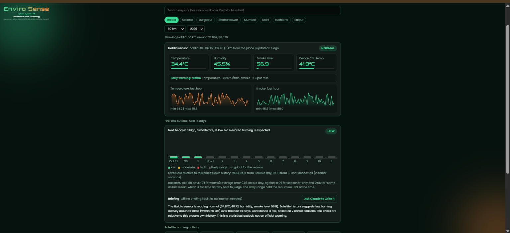
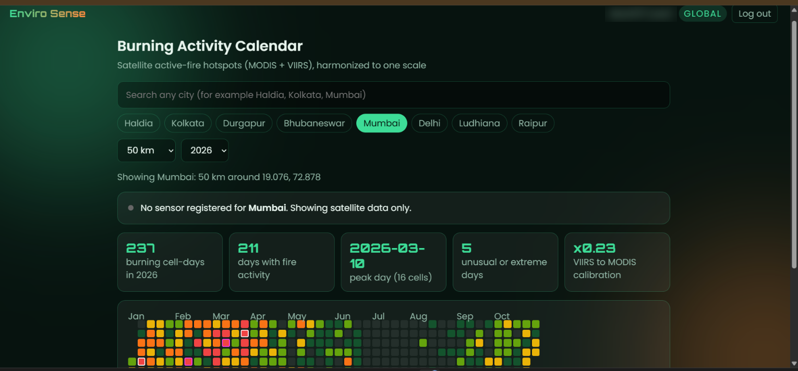
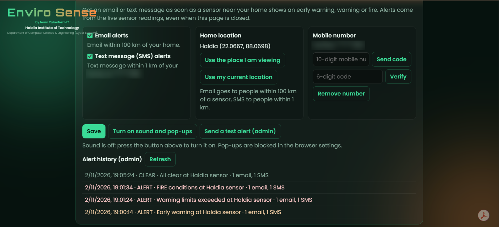
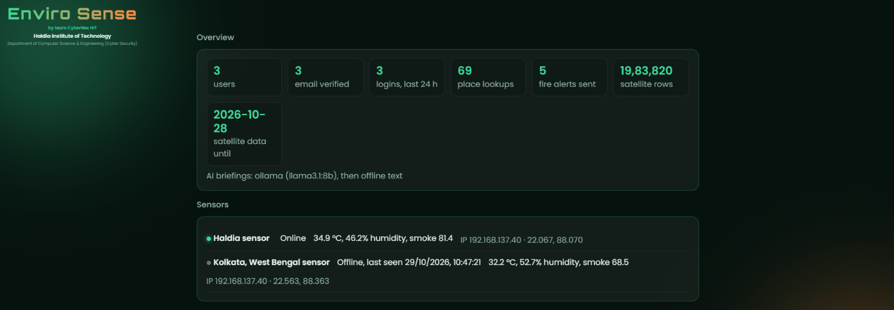
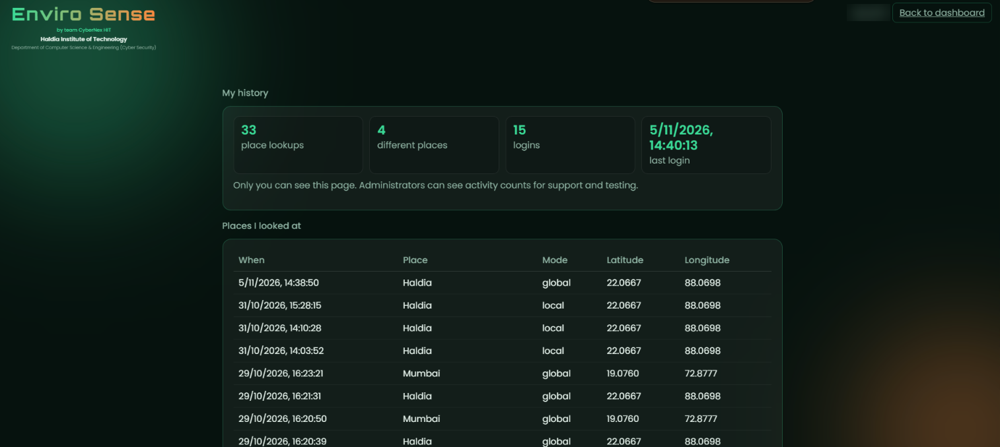
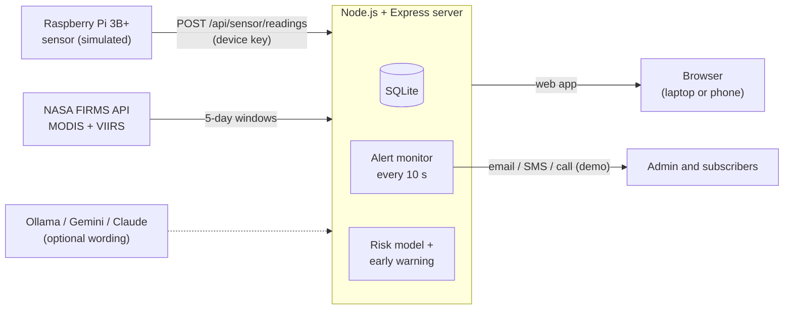

<div align="center">


# Enviro Sense

**NASA satellite fire hotspots + a 14-day fire-risk outlook + a live sensor early warning, in one web app.**

Built by **team CyberNex HIT**, Department of Computer Science & Engineering (Cyber Security), Haldia Institute of Technology.


</div>

> **Please read first**
> - The Raspberry Pi in this repository **only simulates** a sensor. The [real-sensor design](#using-real-sensors-the-hardware-design) is a plan, not built or tested hardware.
> - This is a **student project, not an official warning system**. Risk levels are relative to each place's own history. In an emergency call **112** (India).
> - It was built **with AI assistance from Claude**. See [AI assistance](#ai-assistance-and-authorship).

---

## What it does

Enviro Sense merges the two NASA active-fire satellite instruments (**MODIS** and **VIIRS**) into one **burning-activity calendar** for any place you pick. It shows how an area has burned in the past, flags unusual days, forecasts the next 14 days from the area's own seasonal pattern, and watches a **Raspberry Pi sensor** (temperature, humidity, smoke) that warns early and sends alerts.

## Screenshots

*Taken from a local run, with the simulated Haldia sensor. Personal details are blurred.*

<table>
  <tr>
    <td width="50%"><br><sub><b>Dashboard.</b> Live sensor panel, early-warning trend, 14-day outlook and the plain-language briefing.</sub></td>
    <td width="50%"><br><sub><b>Burning calendar.</b> Global mode, any city; one square per day, unusual days outlined.</sub></td>
  </tr>
  <tr>
    <td width="50%"><br><sub><b>My alerts.</b> Email and SMS opt-in, verified phone number, and the alert history (early warning, warning, fire, all clear).</sub></td>
    <td width="50%"><br><sub><b>Admin panel.</b> Totals, satellite data status, AI status and the sensor registry.</sub></td>
  </tr>
  <tr>
    <td colspan="2" align="center"><br><sub><b>My history.</b> Each user sees only their own lookups and logins.</sub></td>
  </tr>
</table>

## Contents

[Features](#features) · [How it works](#how-it-works) · [Quick start](#quick-start) · [The Raspberry Pi sensor](#the-raspberry-pi-sensor-simulation-only) · [Alerts](#alerts) · [AI briefings](#ai-briefings-optional) · [Free online demo](#free-online-demo-render) · [Settings](#settings-env) · [Project layout](#project-layout) · [Security](#security-notes) · [Limits](#limits-and-honest-notes) · [Credits](#data-and-credits) · [Team](#team)

## Features

| Area | What it does |
|---|---|
| **Burning calendar** | MODIS and VIIRS hotspots combined (same confidence rule, vegetation fires only, snapped to a ~1 km grid, VIIRS calibrated to MODIS). A year view shows every day; "unusual" and "extreme" days are flagged against the same time of year in other years. |
| **14-day outlook** | Seasonal baseline plus a recent-trend adjustment, with a likely range and Low / Moderate / High levels **relative to the place's own history**. A rolling backtest compares it with two simple baselines. It uses fire history only, not weather. |
| **Live sensor** | A Raspberry Pi 3B+ (simulated here) posts temperature, humidity and smoke every 5 s. Readings are classified NORMAL / WARNING / FIRE. |
| **Early warning** | Watches how fast readings rise over 90 s and warns **before** the fixed limits are crossed, with an estimated time to the limit. |
| **Automatic alerts** | A background monitor emails opted-in users within 100 km, texts verified subscribers within 1 km, and adds a **call alert (demo)** for emergencies. One message per escalation, an "all clear" after 3 quiet minutes, plus a banner, sound and pop-up on open dashboards. |
| **Briefings** | Plain-language summary, always available offline. Optionally reworded by an AI model (Ollama, Gemini or Claude) and **checked against the facts**: new numbers or risk words are rejected. |
| **Accounts** | Sign-up with email verification, show/hide password, per-user history, admin panel (users, sensors, logins, alert history). The admin resets the password with a phone code. |
| **Local and Global modes** | *Local*: fixed location, connects to the sensor on this network. *Global*: search any city and see its data and nearest sensor. |
| **Online demo mode** | Guest login, a built-in simulated sensor with "simulate a fire" buttons, and no email codes, for a free test site. |

## How it works



**Tech:** Node.js, Express 5, SQLite (better-sqlite3), vanilla JavaScript front end, signed JWT cookies, Nodemailer (Gmail), Fast2SMS, Python 3 on the Pi.

## Quick start

You need **Node.js 22 or newer** and a free **NASA FIRMS map key** from <https://firms.modaps.eosdis.nasa.gov/api/area/>.

```bash
git clone <your-repo-url>
cd enviro-sense
npm install
cp .env.example .env        # Windows: copy .env.example .env
```

Edit `.env` (at least `JWT_SECRET`, `ADMIN_USER`, `ADMIN_PASS`, `DEVICE_KEY`, `FIRMS_KEY`), then:

```bash
npm start
```

1. Open <http://localhost:3000> and log in as the admin.
2. Open **NASA data and sensors** and start the satellite download (about 35 minutes for 3 years of South Asia; it resumes if interrupted).
3. Open the dashboard and pick a place.

<details>
<summary>Troubleshooting and phone access</summary>

- If `npm install` complains about `better-sqlite3` scripts, approve them with `npm install-scripts approve better-sqlite3` (npm 11) or run `npm rebuild better-sqlite3`.
- **Email and SMS:** with no keys set, codes and alerts print in the server terminal as `[DEMO EMAIL]` and `[DEMO SMS]`. For real email use a Gmail address with an *app password* (`SMTP_USER`, `SMTP_PASS`). For real SMS use Fast2SMS (`FAST2SMS_KEY`); check their rules for sender IDs and templates.
- **On your phone:** on the same Wi-Fi open `http://<laptop-ip>:3000` (find the address with `ipconfig`). Allow port 3000 in Windows Firewall for private networks if it does not load. Browser pop-ups and "use my location" need https and will not work on plain `http`.

</details>

## The Raspberry Pi sensor (simulation only)

**The Raspberry Pi 3B+ is used only to simulate a sensor.** `pi/simulator.py` makes up temperature, humidity, smoke and CPU-temperature values (a daily temperature rhythm plus two demo events) and sends them to the server exactly as a real sensor would. No physical sensor is connected. Everything after the Pi (storage, status, early warning, alerts, dashboard) is real and is what real sensors would feed.

The Pi connects to the laptop by Ethernet (we used Windows Internet Connection Sharing, laptop `192.168.137.1`). On the Pi:

```bash
python3 simulator.py
```

Check `SERVER_URL` and `DEVICE_KEY` at the top of `pi/simulator.py` (the key must equal `DEVICE_KEY` in `.env`). In a second SSH window, start a demo event:

```bash
touch /tmp/smolder     # slow burn: early warning, then warning (about 4 minutes)
touch /tmp/fire        # fast fire (about 40 seconds)
```

To run a second simulated place, copy the script, change `DEVICE_ID` and `LOCATION`, give it its own trigger files, and register the device ID under **Admin: sensors**.

### Using real sensors (the hardware design)

> This is a **design, not tested hardware**. Only `read_sensors()` in `simulator.py` would change; the data format, server and dashboard stay the same.

| Part | Measures | Connects to the Pi | Becomes |
|---|---|---|---|
| **DHT22** (AM2302) | Air temperature, relative humidity | Data wire to GPIO 4, 3.3 V, 10 kΩ pull-up (built into most breakout boards) | `temperature`, `humidity` |
| **MQ-2** | Smoke and combustible gas, as an **analog voltage** | The Pi has no analog inputs, so the output goes through a voltage divider (10 kΩ + 20 kΩ) to the ADC. Needs 5 V for its heater | `smoke` index |
| **ADS1115** 16-bit ADC | Digitizes the MQ-2 voltage | I2C: SDA to GPIO 2, SCL to GPIO 3, 3.3 V, channel A0 | feeds `smoke` |
| **IR flame module** (e.g. KY-026), optional | Infrared light from a flame, short range | Digital output to GPIO 17 | not sent today; needs a small server change |
| **Pi CPU temperature** | Health of the node | `/sys/class/thermal/thermal_zone0/temp` (already in the simulator) | `cpu_temp` |

**How it would work.** Every 5 s the Pi reads the DHT22 (at most once per 2 s) and takes the median of a few MQ-2 samples through the ADS1115 to ignore spikes. The MQ-2 voltage becomes a **smoke index** (reading minus the clean-air baseline measured at start-up, times a scale factor; the server expects 0 to 10000). The Pi sends the same JSON as the simulator with the `x-device-key` header; the server labels it NORMAL, WARNING or FIRE, studies the last 90 s for early warning, and the alert monitor does the rest.

**Calibrate before trusting it.**
- An MQ-2 is **not a calibrated smoke meter**. It needs a long first burn-in (commonly 24 to 48 hours) and 2 to 3 minutes of warm-up at every start, and its reading moves with temperature and humidity.
- The limits in `sensor.js` (smoke 300 / 600, temperature 42 / 55 °C) and `services/earlywarn.js` were tuned on the **simulator**. With real sensors, measure clean air, then a small controlled test (for example an incense stick, outdoors and safely) and set the scale and limits from those measurements.
- Keep the sensor away from cooking, vehicles and direct sun, and protect the electronics from rain.

<details>
<summary>Sketch of a real <code>read_sensors()</code> (untested reference)</summary>

Library names and calls change between versions, so check the Adafruit documentation.

```python
# pip install adafruit-circuitpython-dht adafruit-circuitpython-ads1x15
# sudo apt install libgpiod2
import board, busio, statistics, time
import adafruit_dht
import adafruit_ads1x15.ads1115 as ADS
from adafruit_ads1x15.analog_in import AnalogIn

dht = adafruit_dht.DHT22(board.D4)
ads = ADS.ADS1115(busio.I2C(board.SCL, board.SDA))
mq2 = AnalogIn(ads, ADS.P0)

DIVIDER = 1.5          # undo the 10k + 20k divider (V_sensor = V_adc * 1.5)
CLEAN_AIR_V = 0.0      # set at start-up: median voltage in clean air
SMOKE_SCALE = 400.0    # index units per volt above clean air; tune on a real test

def read_sensors():
    t, h = dht.temperature, dht.humidity           # may raise RuntimeError: retry next loop
    volts = statistics.median(mq2.voltage * DIVIDER for _ in range(5))
    smoke = max(0.0, (volts - CLEAN_AIR_V) * SMOKE_SCALE)
    return {"device_id": DEVICE_ID, "location": LOCATION,
            "temperature": round(t, 1), "humidity": round(h, 1),
            "smoke": round(smoke, 1), "cpu_temp": cpu_temp()}
```

</details>

## Alerts

| Channel | Who gets it | When |
|---|---|---|
| **Email** | Admin, and opted-in users with a verified email **within 100 km** of the sensor | Sensor moves **up** to early warning, warning or fire |
| **SMS** | Admin phone, and opted-in users with a verified number **within 1 km** | Same |
| **Call alert (demo)** | Emergency call demo for fire situations. Without a calling provider configured it is only simulated | Fire situations |
| **Dashboard** | Anyone with the page open | Red banner, sound and browser pop-up |

- Set it up under **My alerts**: choose email and/or SMS, set a home location, and verify your mobile number with a code.
- One message per level, then an **all clear** after 3 quiet minutes.
- Alerts go out immediately with built-in wording. If an AI writer is configured it adds a clearer version in the background, never in the critical path.

## AI briefings (optional)

Set `BRIEF_PROVIDER` to one name or an ordered list such as `gemini,ollama`:

| Provider | Needs | Cost |
|---|---|---|
| `ollama` | Ollama running on your computer | free, works offline |
| `gemini` | `GEMINI_API_KEY` and `GEMINI_MODEL` | free tier |
| `claude` | `ANTHROPIC_API_KEY` | paid |
| `offline` | nothing | built-in text |

The AI only **rewords** the built-in briefing. The server rejects any text that adds numbers or risk words not in the original, tries the next provider, and finally falls back to the offline text.

## Free online demo (Render)

The app can run on a free host so friends can test it without your laptop. Free hosting limits: the service **sleeps after 15 minutes without visits** (about a minute to wake), the **disk is wiped on every restart** (accounts and sensor history reset; satellite data is restored from the bundled seed), and **email cannot be sent** from Render's free tier. Demo mode is built for this: guest login, no email codes, password reset off, and a simulated sensor with "simulate a fire" buttons.

<details>
<summary>Deploy steps</summary>

1. **Build the satellite seed** (server stopped, after your NASA download finished):
   ```bash
   npm run seed
   ```
   This writes `seed/enviro-seed.db.gz` (no users, no readings). If it is over about 90 MB, run `npm run seed -- --from=2024-01-01`.
2. **Put the code on GitHub.** Check `git status` shows no `.env` and no `.db` file, then:
   ```bash
   git init
   git add .
   git commit -m "Enviro Sense"
   git branch -M main
   git remote add origin https://github.com/<you>/enviro-sense.git
   git push -u origin main
   ```
3. **Create the service on Render.** New, then Blueprint, pick the repository (`render.yaml` is included). Enter `ADMIN_USER` and `ADMIN_PASS` when asked; `JWT_SECRET` and `DEVICE_KEY` are generated. `FIRMS_KEY` is optional. If no Blueprint is offered, create a **Web Service** with build command `npm install`, start command `node server.js`, and add the variables from `render.yaml`.
4. Wait for the deploy. The log should show `Seed database unpacked`, `Demo mode: ON` and `Virtual sensor: ON`. Open the URL Render gives you.
5. **Keep it awake (optional):** a free monitor on <https://uptimerobot.com> requesting `https://<your-app>.onrender.com/api/health` every 5 minutes. One always-on service fits Render's 750 free hours a month, but Render does not promise this.

If the build fails on `better-sqlite3`, set `NODE_VERSION` in Render or use the included `Dockerfile` (untested fallback).

</details>

## Settings (`.env`)

| Variable | Purpose |
|---|---|
| `JWT_SECRET` | signs login cookies (16+ random characters, **required**) |
| `ADMIN_USER`, `ADMIN_PASS`, `ADMIN_PHONE`, `ADMIN_EMAIL` | the admin account and where admin alerts go |
| `DEVICE_KEY` | secret the sensor sends with each reading |
| `FIRMS_KEY` | NASA FIRMS key for downloading satellite data |
| `SMTP_USER`, `SMTP_PASS`, `MAIL_FROM` | Gmail sending (empty = print to terminal) |
| `FAST2SMS_KEY`, `FAST2SMS_ROUTE` | SMS sending (empty = print to terminal) |
| `LOCAL_NAME`, `LOCAL_LAT`, `LOCAL_LON` | the fixed Local-mode location (default Haldia) |
| `BRIEF_PROVIDER`, `OLLAMA_*`, `GEMINI_*`, `ANTHROPIC_API_KEY`, `CLAUDE_MODEL` | optional AI wording |
| `DEMO_MODE`, `VIRTUAL_SENSOR` | online demo features |
| `TRUST_PROXY`, `NODE_ENV`, `COOKIE_SECURE` | run behind a host's https proxy with secure cookies |
| `DB_PATH`, `AUTO_SYNC`, `KEEP_READING_DAYS` | database location, daily NASA top-up, reading retention |

## Project layout

```
server.js            app start-up, middleware, routes
auth.js              sign-up, email verification, login, reset
geo.js               Local/Global mode, city search, sensor registry
fire.js              NASA calendar, unusual-day flags, sync/import (admin)
sensor.js            receives and serves sensor readings
forecastapi.js       outlook, sensor early warning, briefing
alertsapi.js         My alerts: preferences, phone verification
adminapi.js          admin panel data        historyapi.js  user history
demoapi.js           guest login + demo controls (demo mode only)
services/            firms (NASA), riskmodel, earlywarn, brief, alerts,
                     mailer, sms, virtual (simulated sensor), ratelimit, ...
public/              pages: index, login, dashboard, history, admin, fire
pi/simulator.py      Raspberry Pi sensor simulator
scripts/make-seed.js builds the bundled satellite data for hosting
docs/                logo and screenshots used in this README
seed/                (you create) enviro-seed.db.gz
```

## Security notes

- **Never commit `.env` or the database.** `.gitignore` already excludes them. If a key was ever shared in public, create a new one.
- Passwords are hashed (bcrypt). Login cookies are `httpOnly` and, in production, `secure`. Verification and reset codes are stored hashed, expire in 10 minutes and allow 5 tries. Login, sign-up and reset are rate limited. A mobile number must be verified before it can receive alerts.
- In **demo mode** anyone can sign up without an email check and password reset is off. Use it only for testing, with fake details, and never reuse real passwords.
- Set a strong `ADMIN_PASS` on the host. Do not publish it in the repository.

## Limits and honest notes

- Satellite detections are a **statistical outlook**, not a prediction of a specific fire, and the data lags real time. The thresholds for "unusual" days and the early warning were tuned on test data and the simulator, not on a real deployment.
- The outlook is relative to each place's own history, so "high" in a quiet area is not comparable with "high" elsewhere.
- The sensor in this version is **simulated**. The hardware design above has not been built or tested, and real smoke and temperature sensors need calibration and careful placement.
- Real SMS, email and phone-call delivery depend on third-party accounts; without keys they only print to the server terminal.
- AI wording is optional and validated against the facts, but it is still generated text.

## Data and credits

- **Fire detections:** NASA FIRMS (MODIS and VIIRS active fire data). We acknowledge the use of data and imagery from NASA's Fire Information for Resource Management System (FIRMS), part of NASA's Earth Science Data and Information System (ESDIS). <https://firms.modaps.eosdis.nasa.gov/>
- **City search:** [Open-Meteo Geocoding](https://open-meteo.com/) (CC BY 4.0, free for non-commercial use).

## AI assistance and authorship

This project was built **with the help of an AI assistant, Claude (by Anthropic)**. Claude was used throughout to write and review code, including the front end (pages, styling and scripts in `public/`), the server and the Raspberry Pi simulator, and to help write this README. The AI-written wording in the app (see [AI briefings](#ai-briefings-optional)) is a separate, optional runtime feature.

The team defined the idea and requirements, tested each step on its own computer and Raspberry Pi, configured the keys and accounts, and deployed the demo. Please read, test and understand any code before relying on it.

## Team

**CyberNex HIT** · Department of Computer Science & Engineering (Cyber Security) · Haldia Institute of Technology

+------------+-------------------------+
| Member     |         Role            |
+------------+-------------------------+
| Akash Adak | Leader / Lead Developer |
| Arpita Dey | Co-leader / Presenter   |
| Arya Das   | Developer               |
| Raja Ghosh | Presentation Designer   |
| Sayan Pal  | Presenter               |
+------------+-------------------------+
## License

No license has been chosen yet. Add a `LICENSE` file (for example MIT) before making the repository public. Until then all rights are reserved by the authors.
